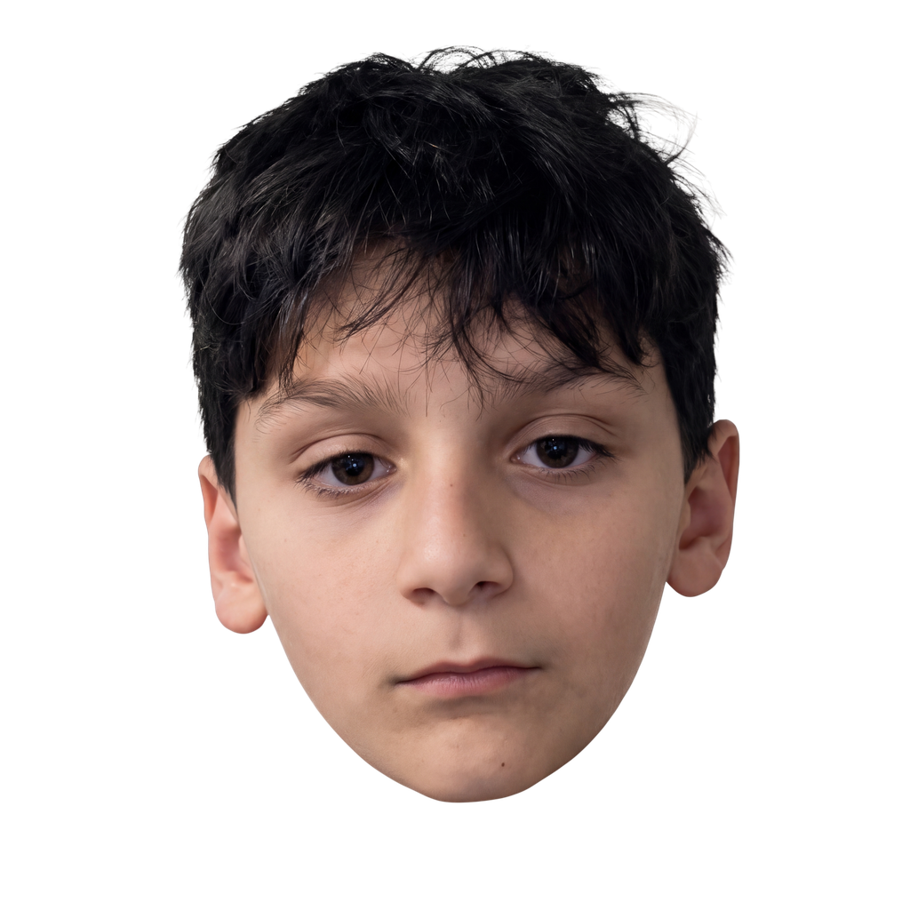

# Matthew Clicker 🚀🎮

The ultimate polished indie clicker game starring Matthew! Built from scratch with React, TypeScript, Vite, Tailwind CSS, HTML5 Canvas Particle Engine, and a synthesized Web Audio system.



---

## 🌟 Key Features

- **The Main Clicker Loop**: Click Matthew to earn **Matthew Coins ($MC)**. Features responsive character squash & stretch animations, click ripples, and floating critical damage numbers.
- **16 Unique Collectible Skins**: All 16 skins are generated with distinct game artwork while 100% preserving Matthew's authentic likeness and framing:
  1. *Classic Matthew* (Common)
  2. *Sad Matthew* (Common)
  3. *Sleepy Matthew* (Common)
  4. *Angry Matthew* (Rare)
  5. *Aura Matthew* (Rare)
  6. *Sigma Matthew* (Rare)
  7. *Rich Matthew* (Epic)
  8. *Evil Matthew* (Epic)
  9. *Fire Matthew* (Epic)
  10. *Ice Matthew* (Epic)
  11. *Golden Matthew* (Legendary)
  12. *Diamond Matthew* (Legendary)
  13. *Rainbow Matthew* (Legendary)
  14. *Glitch Matthew* (Mythic)
  15. *Galaxy Matthew* (Mythic)
  16. *God Matthew* (Divine)
- **12 Progressive Upgrades**: From *Stronger Clicks* and *Matthew's Mouse* to *Matthew Factory*, *Aura Generator*, and *Ultimate Matthew Machine*. Includes **1x, 10x, 100x, and MAX** bulk purchase modes.
- **Cosmic Ascension (Prestige)**: Reset coins and upgrades for permanent **Matthew Shards** (+2% earnings each) and unlock the eternal celestial skill tree.
- **Rare Bonus Events**: Flying **Golden Matthew** randomly darts across your screen. Catching him triggers a **7X Frenzy** or a giant coin bounty!
- **18 Achievements**: Rewarding badges for clicking speed, combo milestones, upgrades, and skin collection.
- **Synthesized Web Audio Engine**: Zero external audio files required! 100% procedurally generated retro sound effects and ambient chill synthwave music with volume sliders and mute toggles.
- **Robust Local Saves & Offline Earnings**: Automatically saves every 5 seconds. Earn coins while away for up to 8 hours with a welcome back reward modal. Supports one-click save code export and import.
- **GitHub Pages Ready**: Configured with relative asset paths and an automated GitHub Actions deployment workflow.

---

## 🕹️ Quick Start (Running Locally)

### Prerequisites

- [Node.js](https://nodejs.org/) (version 18, 20, 22, or higher)
- [Python 3](https://www.python.org/) (optional, only required if you want to rerun image processing scripts)

### Installation

1. Open your terminal in this directory:
   ```bash
   cd "w:\Mathew Clicker"
   ```

2. Install dependencies:
   ```bash
   npm install
   ```

3. Launch the development server:
   ```bash
   npm run dev
   ```
   Open your browser to `http://localhost:5173/` and start clicking Matthew!

4. Build and preview the production bundle:
   ```bash
   npm run build
   npm run preview
   ```

5. Run automated test suite:
   ```bash
   npm test
   ```

---

## 🎨 Asset Processing & Python Tools

The original source photo is safely preserved in the `Images/` directory.

### Automatic Background Removal (`rembg`)
To process new photos or extract clean transparent backgrounds using the U2-Net deep learning model:
```bash
py scripts/remove_background.py --input "Images/Main Matthew.png" --output "public/images/skins/classic_matthew.png" --size 1024
```
For batch processing a directory of images:
```bash
py scripts/remove_background.py --input "my_photos" --output "public/images/skins" --batch
```

### Regenerating the 16 Skins
To regenerate all 16 character skins:
```bash
py scripts/generate_skins.py
```

### Economy Simulator
To run the automated pacing and progression verification:
```bash
npx tsx scripts/simulate_economy.ts
```

---

## 🌐 Deploying to GitHub Pages (100% Free Hosting)

Follow these beginner-friendly steps to publish the game online so anyone can play in their browser for free.

### Step 1: Create a Free GitHub Account
If you don't already have one, create a free account at [github.com](https://github.com/).

### Step 2: Create a New Repository
1. On GitHub, click the **+** icon in the top right and select **New repository**.
2. Set the repository name to:
   ```
   matthew-clicker
   ```
3. Set the repository to **Public**.
4. Leave *Add a README file*, *.gitignore*, and *license* **unchecked** (we already created them).
5. Click **Create repository**.

### Step 3: Initialize Git and Push Your Project
In your project folder, run the following commands (replace `YOUR_USERNAME` with your actual GitHub username):

```bash
git init
git add .
git commit -m "Initial commit: Complete Matthew Clicker Game"
git branch -M main
git remote add origin https://github.com/YOUR_USERNAME/matthew-clicker.git
git push -u origin main
```

*(Note: `.gitignore` automatically prevents `node_modules/` or temporary files from being uploaded.)*

### Step 4: Enable GitHub Pages with GitHub Actions
1. On your repository page on GitHub, click **Settings** (gear icon near the top right).
2. In the left sidebar, click **Pages** (under "Code and automation").
3. Under **Build and deployment > Source**, select:
   ```
   GitHub Actions
   ```
4. That's it! GitHub will now automatically run the workflow in `.github/workflows/deploy.yml`.

### Step 5: Play Your Published Game!
1. Click the **Actions** tab at the top of your GitHub repository.
2. You will see the **Deploy Matthew Clicker to GitHub Pages** workflow running.
3. Wait about 1–2 minutes until you see a green checkmark `✔`.
4. Your finished game is now live at:
   ```
   https://YOUR_USERNAME.github.io/matthew-clicker/
   ```
   Share the link with friends, family, and Matthew!

### Updating the Game Later
Whenever you make changes, simply commit and push them:
```bash
git add .
git commit -m "Update game"
git push
```
GitHub Actions will automatically rebuild and update your live website.

---

## 🛡️ License

Created with ❤️ for Matthew. Free and open source.
